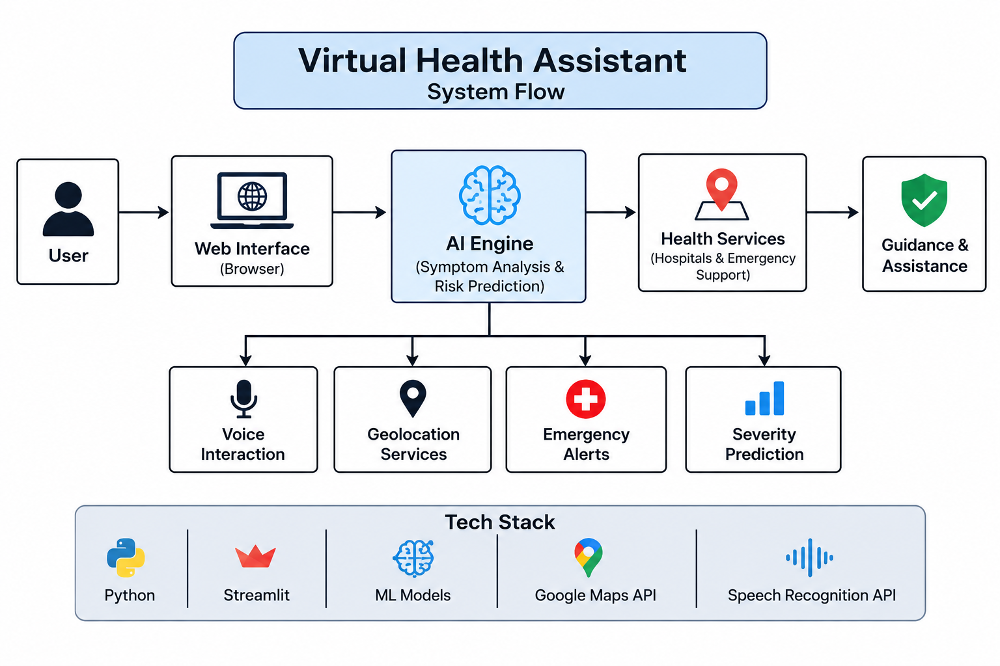

# Virtual Health Assistant

An AI-assisted healthcare and safety platform designed to provide preliminary symptom analysis, health guidance, severity assessment, and access to nearby healthcare facilities.

## Project Overview

Virtual Health Assistant is a healthcare support application that combines symptom analysis, voice interaction, location-based services, and emergency assistance. It aims to improve access to preliminary healthcare information and help users identify appropriate next steps based on their reported symptoms.

The application is intended for informational and educational purposes and does not replace professional medical consultation.

## Key Features

- **Symptom Analysis:** Processes user-reported symptoms to provide preliminary health guidance.
- **Severity Prediction:** Estimates potential symptom severity to support informed decision-making.
- **Personalized Guidance:** Provides health-related suggestions based on submitted information.
- **Voice Interaction:** Supports voice-based input to improve accessibility.
- **Location Detection:** Uses geolocation services to identify the user's location.
- **Nearby Hospital Discovery:** Helps users locate nearby healthcare facilities.
- **Emergency Assistance:** Provides access to relevant emergency support resources.

## System Architecture

The application follows a workflow that connects user input, AI-based processing, and healthcare support services.



### Application Workflow

1. The user provides symptoms or health-related information through the web interface.
2. The application processes the submitted information.
3. The AI component performs symptom analysis and estimates potential severity.
4. Location services identify relevant nearby healthcare facilities.
5. The application presents preliminary guidance and available support information.

## Technology Stack

The project incorporates the following technology categories:

| Component | Purpose |
|---|---|
| Python | Application logic and processing, if used |
| AI / Machine Learning | Symptom analysis and severity prediction |
| Voice Processing | Voice-based user interaction |
| Geolocation APIs | Location detection |
| REST APIs | Communication with external services, where applicable |
| HTML, CSS, JavaScript | Web interface, as applicable |

**Note:** Exact frameworks, machine learning libraries, models, and API providers should be documented according to the actual implementation.

## Repository Structure

```text
Virtual-Health-Assistant/
│
├── index.html
├── README.md
└── assets/
    └── virtual-health-assistant-flow.png
```

Additional application files, models, configuration files, and dependencies should be included in this structure as the implementation evolves.

## Installation and Execution

### Prerequisites

- Git
- A modern web browser
- Visual Studio Code or another code editor
- Python and required packages, if the backend implementation uses Python
- API credentials, if external services require authentication

### Clone the Repository

```bash
git clone https://github.com/shruthigs083/virtual-health-assistance.git
```

Navigate to the project directory:

```bash
cd virtual-health-assistance
```

### Run the Application

If the current implementation is a standalone HTML application, open `index.html` in a web browser.

If a Python backend or framework is included, install the dependencies listed in the project's requirements file and use the appropriate application startup command.

## Project Achievement

**Third Place – Hackaphasia**

The Virtual Health Assistant project secured third place among 150 participating teams.

## Potential Future Improvements

- Improve symptom classification and prediction accuracy.
- Expand multilingual voice interaction.
- Integrate verified healthcare facility information.
- Improve location-based emergency assistance.
- Strengthen data privacy and application security.
- Enhance accessibility and mobile responsiveness.

## Limitations and Disclaimer

Virtual Health Assistant provides preliminary health-related information only. Its predictions and recommendations are not medical diagnoses and must not be used as a substitute for professional medical advice or treatment.

In an emergency, users should contact local emergency services or seek immediate medical assistance.

## Contributors

**Shruthi G S**

GitHub: [@shruthigs083](https://github.com/shruthigs083)

## License

A license should be added after confirming the project's distribution and usage permissions.

---

*Developed as a technology project exploring the application of artificial intelligence and location-based services in healthcare accessibility.*
